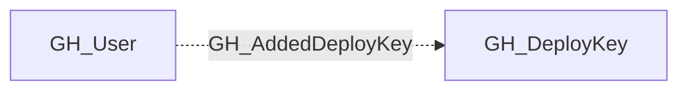

# GH_AddedDeployKey

## General Information

User added this repository deploy key.

## Diagram

## References

- [Deployment environments API](https://docs.github.com/en/rest/deployments/environments)
