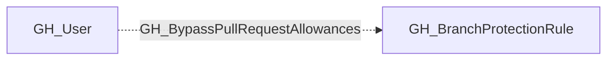

# GH_BypassPullRequestAllowances

## General Information

The non-traversable GH_BypassPullRequestAllowances edge records a configured exception to pull request requirements on a branch protection rule. Sources include users, teams, and App Installations.

GitHub App actors are resolved to active organization installations with access to the rule's repository. An App exception does not by itself grant repository write permission or establish effective branch-write access; other protection requirements still need evaluation. Missing, suspended, inaccessible, or ambiguous installations are not linked.

## Edge Schema

| Source | Destination | Traversable |
| --- | --- | --- |
| `GH_User` | `GH_BranchProtectionRule` | `false` |
| `GH_Team` | `GH_BranchProtectionRule` | `false` |
| `GH_AppInstallation` | `GH_BranchProtectionRule` | `false` |

## Diagram

