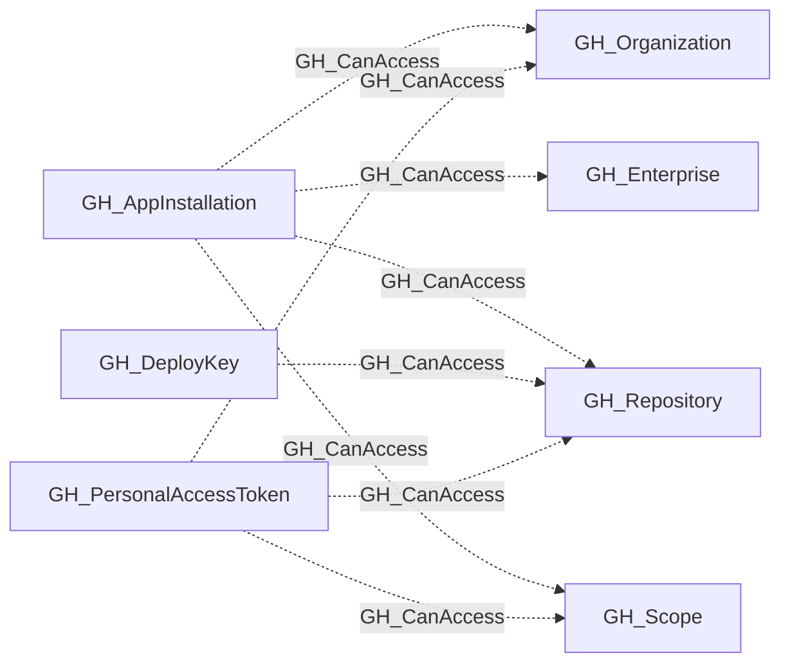

# GH_CanAccess

## General Information

The non-traversable GH_CanAccess edge records the resource scope of a personal access token, pending PAT request, app installation, or deploy key. Targets can be repositories, reusable scopes, organizations, or enterprises. All-repository app installations and PATs point to an organization-scoped GH_Scope with `scope_type=repository` instead of repeating an edge to every repository. This edge represents access scope rather than a direct attack path.

App Installations also point directly to their installation target: an organization installation links to `GH_Organization`, and an enterprise installation links to `GH_Enterprise`. Enterprise installation access does not imply access to child organizations or repositories. The edge records installation access scope; specific permissions and suspension status remain properties of the installation. Unresolved targets produce no access edge.

For PATs and PAT requests, organization targets require nonempty `permissions_organization`. Enterprise targets require nonempty `permissions_enterprise` and a uniquely matched collected parent enterprise. An all-repository selection uses the shared scope; selected repositories use direct edges. On pending requests these relationships record requested scope, not approval or active capabilities.

## Edge Schema

| Source | Destination | Traversable |
| --- | --- | --- |
| `GH_AppInstallation` | `GH_Organization` | `false` |
| `GH_AppInstallation` | `GH_Enterprise` | `false` |
| `GH_AppInstallation` | `GH_Repository` | `false` |
| `GH_AppInstallation` | `GH_Scope` | `false` |
| `GH_DeployKey` | `GH_Repository` | `false` |
| `GH_PersonalAccessToken` | `GH_Organization` | `false` |
| `GH_PersonalAccessToken` | `GH_Repository` | `false` |
| `GH_PersonalAccessToken` | `GH_Scope` | `false` |
| `GH_PersonalAccessToken` | `GH_Enterprise` | `false` |
| `GH_PersonalAccessTokenRequest` | `GH_Organization` | `false` |
| `GH_PersonalAccessTokenRequest` | `GH_Enterprise` | `false` |
| `GH_PersonalAccessTokenRequest` | `GH_Repository` | `false` |
| `GH_PersonalAccessTokenRequest` | `GH_Scope` | `false` |

## Diagram

