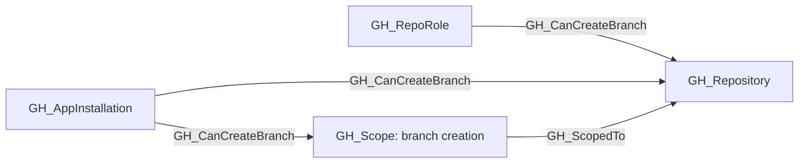

# GH_CanCreateBranch

## General Information

The traversable GH_CanCreateBranch edge indicates the ability to create freely named new branches in a repository. Restrictions on specific names, such as `main` or `release/*`, may remain; this capability does not imply the ability to create every branch name or modify workflow files.

Active organization App installations require granted `contents:write` and repository access. All-repository installations point to an organization-scoped GH_Scope with `scope_type=repository_branch_creation` and `scope=unrestricted`. Its traversable GH_ScopedTo edges enumerate eligible repositories. Selected-repository installations point directly to eligible granted repositories. A matching App push allowance can produce a direct edge outside the shared scope when it satisfies every collected broad creation restriction. Unknown patterns do not establish eligibility. App capability edges include a reason and a composition query showing permission/access evidence.

Older collections without the capability scope use direct installation-to-repository edges. Empty scopes receive no incoming capability edge. Suspended installations, archived/disabled repositories, missing default branches, and unresolved collected protection rules do not produce installation capability paths. Enterprise installations do not imply organization repository access.

Existing repository roles use the same conservative creation-restriction classification with their existing role bypass checks. The calculation evaluates collected classic branch protections; rulesets and overlapping-rule precedence are not resolved, and incomplete collection may still omit restrictions.

Fine-grained PATs require `contents:write`, an unexpired token, and granted repository access. Each target must also be reachable through the owner's existing repository-role branch-creation capability, including collected team and organization-role inheritance. All-repository PATs use the shared scope only when the owner has authority over every member; partial authority and selected grants use direct repository edges. Composition queries include the owner's capability path. User/team allowances not yet represented by owner GH_CanCreateBranch paths do not independently grant PAT capabilities. Pending requests receive no active capability edges.

## Scenarios

### Shared repository eligibility

Exact branch names, literal namespaces, and star patterns requiring specific text (such as `*protections_test*`) leave other names available. Broad creation restrictions and unsupported patterns exclude a repository from the shared scope. Creation restrictions apply only when push restrictions are also enabled.

## Edge Schema

| Source | Destination | Traversable |
| --- | --- | --- |
| `GH_RepoRole` | `GH_Repository` | `true` |
| `GH_AppInstallation` | `GH_Repository` | `true` |
| `GH_AppInstallation` | `GH_Scope` | `true` |
| `GH_PersonalAccessToken` | `GH_Repository` | `true` |
| `GH_PersonalAccessToken` | `GH_Scope` | `true` |

## Diagram

