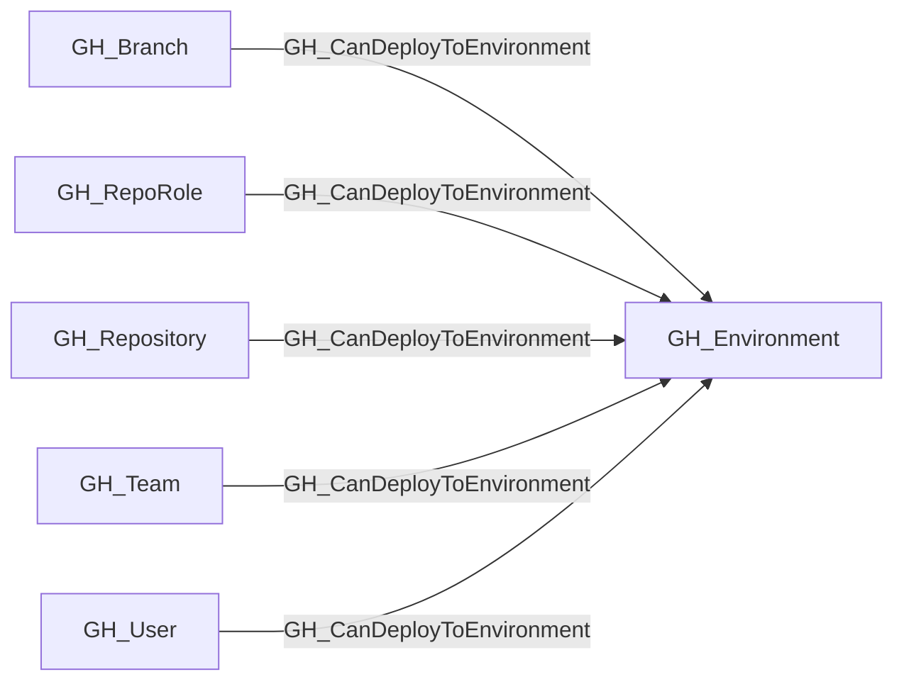

# GH_CanDeployToEnvironment

## General Information

The traversable GH_CanDeployToEnvironment edge represents the ability for a repository, branch, repository role, or reviewer to satisfy the modeled deployment constraints for a GitHub Environment.

This edge is computed from environment deployment branch policy, branch protection state, required reviewer behavior, and administrator bypass behavior. For environments without required reviewers, unrestricted environments emit repository and branch edges, protected-branch-only environments emit edges only for protected branches unless no branch protection rules exist, and custom branch policies emit edges only for matching branches.

When required reviewers are configured and self-review is allowed, a configured GH_User or GH_Team reviewer receives GH_CanDeployToEnvironment only when the same actor can also supply deployable code. For unrestricted environments this means the actor can create a branch in the repository. For protected-branch-only or custom branch policy environments this means the actor can write to an eligible branch under the existing GH_CanWriteBranch rules.

Self-review alone is not sufficient for this edge. GH_ApprovesDeploymentTo remains the non-traversable representation of reviewer authority, while GH_CanDeployToEnvironment represents the combined ability to satisfy both the approval gate and the code-supply path. When prevent_self_review is enabled, no direct deploy edge is emitted for the reviewer because the required split-principal flow is not currently modeled.

## Diagram



## Abuse Info

A source repository, branch, role or reviewer can reach an environment only when the modeled deployment policy and reviewer/admin conditions are satisfied. The reviewer edge requires both self-approval and a deployable code path; review assignment alone is GH_ApprovesDeploymentTo.

Abuse using GitHub UI:

Open the run's Review deployments view and compare it with repository Settings > Environments. Confirm the run ref is eligible before interpreting approval as a complete attack path.

Abuse using API:

1. Authenticate in the source context and set the exact destination identifiers. These examples require Bash, curl and jq. URL-encode path values that contain reserved characters. Use the configured server API root for GitHub Enterprise Server.

```bash
set -euo pipefail
export GITHUB_API="https://api.github.com"
export GITHUB_TOKEN="REPLACE_WITH_AUTHORIZED_TOKEN"
export OWNER="controlled-org"
export REPO="controlled-repo"
export ENVIRONMENT="controlled-canary"
export RUN_ID="1"
api() {
  curl --fail-with-body -sS \
    -H "Authorization: Bearer $GITHUB_TOKEN" \
    -H "Accept: application/vnd.github+json" \
    -H "X-GitHub-Api-Version: 2022-11-28" \
    "$GITHUB_API$1"
}
```

2. Check the source grant or execution context. Successful JSON reads return HTTP 200; authorization failures do not validate the path.

```bash
api "/repos/$OWNER/$REPO/environments/$ENVIRONMENT" | jq '{id,name,protection_rules,deployment_branch_policy,can_admins_bypass}'
```

3. Verify the destination or adjacent control, then interpret the result within the edge's scope. Paginated listings require following all pages when used for complete coverage.

```bash
api "/repos/$OWNER/$REPO/actions/runs/$RUN_ID/pending_deployments" | jq '.[]|{environment,current_user_can_approve,reviewers}'
```

An environment record plus current_user_can_approve is supporting evidence, not completed deployment. Inspect the actual run's ref, reviewer identity, self-review policy and custom protection rules. A successful job after those gates is needed to establish a live deployment.

## Opsec Considerations

Deployment review history, Actions run logs and audit events identify the actor and environment. Do not treat an existing reviewer relationship as evidence that the actor approved a particular run.

## References

- [Deployment environments API](https://docs.github.com/en/rest/deployments/environments)
- [Workflow runs API](https://docs.github.com/en/rest/actions/workflow-runs)
