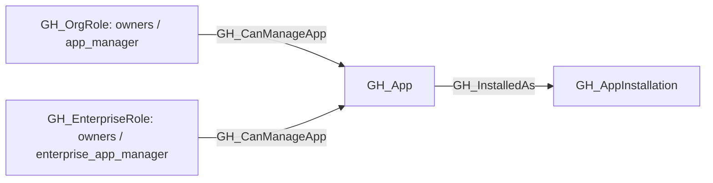

# GH_CanManageApp

## General Information

The traversable GH_CanManageApp edge represents control over a GitHub App registration, including generating authentication credentials. Those credentials can be used to request tokens for the App's existing installations. The path continues through GH_InstalledAs to installation capabilities, within each installation's granted permissions and repository selection.

Organization `owners` and predefined `app_manager` roles receive this capability for Apps registered to their exact organization. Enterprise `owners` and predefined `enterprise_app_manager` roles receive it for Apps registered to their exact enterprise. Empty raw permission arrays do not remove these built-in capabilities. Custom roles with matching names do not qualify.

The composed edge records the role's account containment and that account's GH_Owns relationship to the App. Registration owner type and node ID are matched exactly; installation locations, collection context, membership, and child-account hierarchy do not establish App management. Enterprise App managers do not automatically manage organization-owned Apps. Personally owned Apps retain the owning user's existing GH_Owns relationship.

This capability does not automatically grant installation management, approval of expanded requested permissions, or access beyond the App's existing installation grants. Per-App manager assignment enumeration remains a collection gap; these edges currently describe account-wide predefined role authority, not a complete manager inventory.

## Edge Schema

| Source | Destination | Traversable |
| --- | --- | --- |
| `GH_OrgRole` | `GH_App` | `true` |
| `GH_EnterpriseRole` | `GH_App` | `true` |

## Diagram

