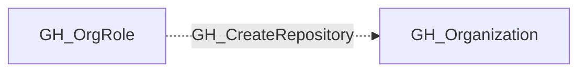

# GH_CreateRepository

## General Information

The non-traversable GH_CreateRepository edge represents that a role has the ability to create new repositories within the organization. This permission is available to Owners and custom organization roles that have been granted the repository creation permission. Creating repositories can introduce new attack surface to an organization, as each new repository is a potential vector for code execution through GitHub Actions workflows, secret exposure, and supply chain attacks.

## Diagram

## Collection Limits

This kind remains in the checked-in schema but has no current model EdgeDef registration. Current creation capabilities use GH_CanCreateRepositories and the visibility-specific GH_CanCreatePublicRepositories, GH_CanCreatePrivateRepositories and GH_CanCreateInternalRepositories kinds. Do not treat this schema entry alone as evidence that a current collection emits GH_CreateRepository.

## References

- [Organization roles](https://docs.github.com/en/organizations/managing-peoples-access-to-your-organization-with-roles/roles-in-an-organization)
- [Custom organization role API](https://docs.github.com/en/enterprise-cloud@latest/rest/orgs/organization-roles)
