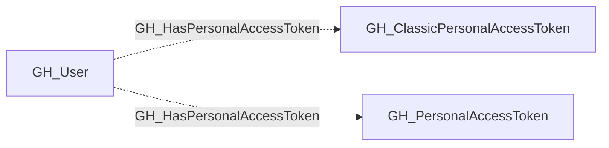

# GH_HasPersonalAccessToken

## General Information

The non-traversable GH_HasPersonalAccessToken edge links a user to a personal access token they own. Fine-grained token ownership comes from organization approvals; classic token ownership comes from the enterprise credential inventory. The edge identifies the owner but does not by itself grant access to any organization or repository.

## Diagram

## References

- [Personal access token API](https://docs.github.com/en/rest/orgs/personal-access-tokens)
- [GitHub App installations API](https://docs.github.com/en/rest/apps/installations)
