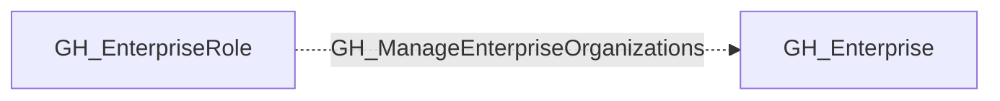

# GH_ManageEnterpriseOrganizations

## General Information

[Enterprise] Enterprise role can manage organizations.

## Diagram

## References

- [Enterprise roles](https://docs.github.com/en/enterprise-cloud@latest/rest/enterprise-admin/enterprise-roles)
