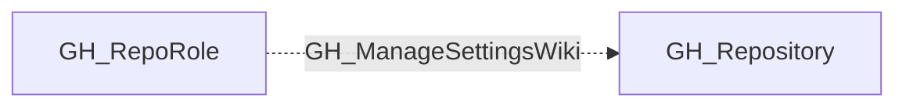

# GH_ManageSettingsWiki

## General Information

The non-traversable GH_ManageSettingsWiki edge represents a role's ability to enable or disable the repository wiki. This permission is available to Maintain and Admin roles and custom roles that have been granted this specific permission.

## Diagram

## References

- [Repository roles](https://docs.github.com/en/organizations/managing-access-to-your-organizations-repositories/repository-roles-for-an-organization)
