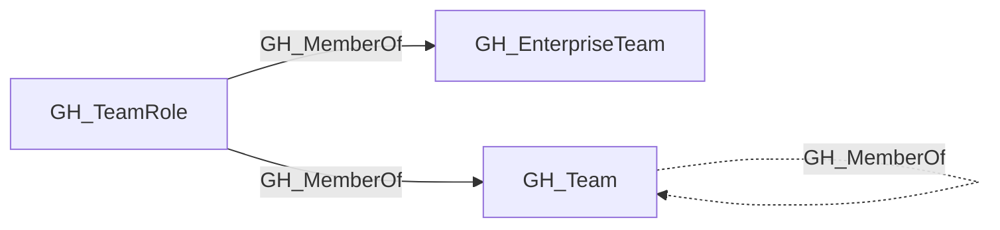

# GH_MemberOf

## General Information

GH_MemberOf links a team role to its organization or enterprise team, or a child organization team to its parent. Enterprise team organization assignments use GH_AssignedTo; repository grants attach directly to the enterprise team.

Team-role membership is traversable. Organization team nesting is emitted as non-traversable; consult the deployed relationship-kind configuration for pathfinding behavior.

## Edge Schema

| Source | Destination | Traversable |
| --- | --- | --- |
| `GH_Team` | `GH_Team` | `false` |
| `GH_TeamRole` | `GH_EnterpriseTeam` | `true` |
| `GH_TeamRole` | `GH_Team` | `true` |

## Diagram

