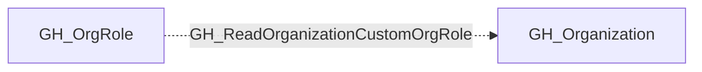

# GH_ReadOrganizationCustomOrgRole

## General Information

The non-traversable GH_ReadOrganizationCustomOrgRole edge represents that a role can read custom organization role definitions. This edge is dynamically generated from custom organization role permissions discovered by the collector. Reading custom org role definitions allows a user to enumerate the permissions granted to each custom role, which provides reconnaissance value for understanding the organization's access control model and identifying roles with elevated privileges.

## Diagram

## References

- [Organization roles](https://docs.github.com/en/organizations/managing-peoples-access-to-your-organization-with-roles/roles-in-an-organization)
- [Custom organization role API](https://docs.github.com/en/enterprise-cloud@latest/rest/orgs/organization-roles)
