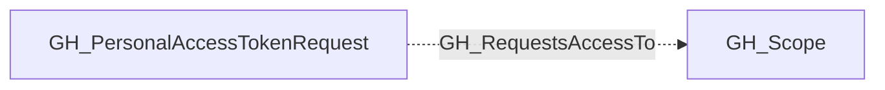

# GH_RequestsAccessTo

## General Information

The non-traversable GH_RequestsAccessTo edge records access sought by a pending fine-grained personal access token request. It is distinct from GH_CanAccess, which represents access GitHub has already granted. An all-repository request targets the organization's reusable repository/all GH_Scope.

## Diagram

## References

- [Personal access token API](https://docs.github.com/en/rest/orgs/personal-access-tokens)
- [GitHub App installations API](https://docs.github.com/en/rest/apps/installations)
