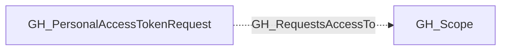

# GH_RequestsAccessTo

## General Information

Legacy non-traversable scope relationship for pending PAT requests. New exports use GH_CanAccess for requested resource scope, with the pending request node identifying that access has not been approved. This relationship remains documented for older graphs.

## Edge Schema

| Source | Destination | Traversable |
| --- | --- | --- |
| `GH_PersonalAccessTokenRequest` | `GH_Scope` | `false` |

## Diagram

