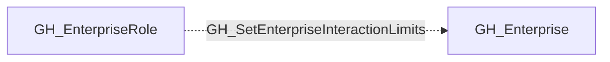

# GH_SetEnterpriseInteractionLimits

## General Information

[Enterprise] Enterprise role can set interaction limits.

## Diagram

## References

- [Enterprise roles](https://docs.github.com/en/enterprise-cloud@latest/rest/enterprise-admin/enterprise-roles)
