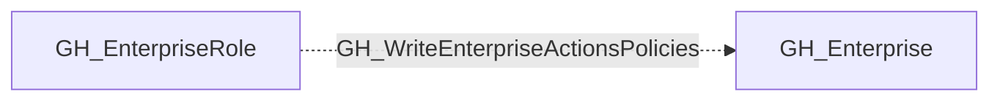

# GH_WriteEnterpriseActionsPolicies

## General Information

[Enterprise] Enterprise role can write Actions policies.

## Diagram

## References

- [Enterprise roles](https://docs.github.com/en/enterprise-cloud@latest/rest/enterprise-admin/enterprise-roles)
