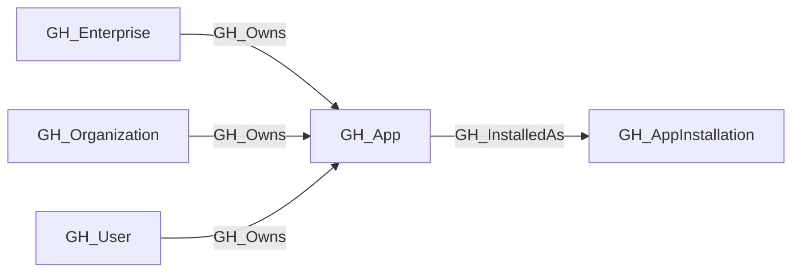

# GH_App

## General Information

Represents a GitHub App definition — the registered application entity. The app owner holds the private key that can generate installation access tokens for **every** GH_AppInstallation of this app. If the private key is compromised, all installations across all organizations and enterprises are affected.

App definitions are retrieved via `GET /apps/{app_slug}` after discovering app slugs from organization installations or the collector app's enterprise installation. Authenticated lookup can also retrieve private/internal apps where GitHub permits access. The `permissions` property records requested app permissions; each installation separately records its granted permissions.

`registration_origin` classifies registration ownership using the collected inventory:

- `tenant_owned`: The owner is a collected organization or the collected enterprise.
- `member_owned`: The owner is a collected organization or enterprise member. The app remains owned by the user's account; membership does not imply tenant control or approval of the app.
- `third_party`: The owner is a user, organization, or enterprise without matching internal ownership or membership evidence. This is the default for recognized owners, including in organization-only collections; incomplete inventory can affect classification.
- `unknown`: Owner metadata is missing or its type is unsupported.

Organization membership is established from `membersWithRole`, and enterprise membership from the enterprise member inventory. Outside-collaborator status alone does not establish membership.

## Properties

| Property | Type | Description |
| --- | --- | --- |
| `name` | `string` | The node name used for matching and display. |
| `displayname` | `string` | The human-readable display name. |
| `environment_slug` | `string` | The organization login or enterprise slug where the app was collected. |
| `environmentid` | `string` | The identifier of the GitHub environment where this node was collected. |
| `last_seen` | `datetime` | The timestamp when this node was last observed during collection. |
| `node_id` | `string` | The stable identifier used as the OpenGraph node ID; this is the native GitHub node ID where available. |
| `id` | `integer` | The GitHub App's numeric ID. |
| `client_id` | `string` | The app's OAuth client ID. |
| `slug` | `string` | The app's URL-friendly slug identifier. |
| `description` | `string` | The app's description. |
| `external_url` | `string` | The app's external homepage URL. |
| `html_url` | `string` | URL to the app's GitHub page. |
| `owner_login` | `string` | The login of the user or organization that owns the app. |
| `owner_node_id` | `string` | The node_id of the user or organization that owns the app. |
| `owner_type` | `string` | The type of the owner (e.g., `User`, `Organization`). |
| `permissions` | `list[string]` | Requested app permissions in `scope:access` form. |
| `registration_origin` | `string` | `tenant_owned`, `member_owned`, `third_party`, or `unknown`, based on collected ownership and membership evidence. |
| `events` | `list[string]` | JSON string of the default webhook events the app subscribes to. |
| `installations_count` | `integer` | The total number of installations of this app across all organizations. |
| `created_at` | `datetime` | When the app was created. |
| `updated_at` | `datetime` | When the app was last updated. |
| `query_owner` | `string` | Query for the account that registered the app. |
| `query_installations` | `string` | Query for installations. |

## Diagram

