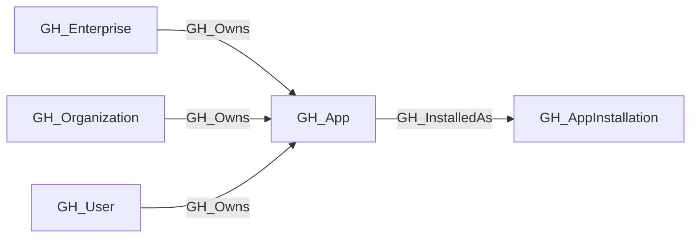

# GH_App

## General Information

Represents a GitHub App definition — the registered application entity. The app owner holds the private key that can generate installation access tokens for **every** GH_AppInstallation of this app. If the private key is compromised, all installations across all organizations and enterprises are affected.

App definitions are retrieved via `GET /apps/{app_slug}` after discovering app slugs from organization installations or the collector app's enterprise installation. Authenticated lookup can also retrieve private/internal apps where GitHub permits access. The `permissions` property records requested app permissions; each installation separately records its granted permissions.

## Diagram

## References

- [GitHub App installation authentication](https://docs.github.com/en/apps/creating-github-apps/authenticating-with-a-github-app/authenticating-as-a-github-app-installation)
