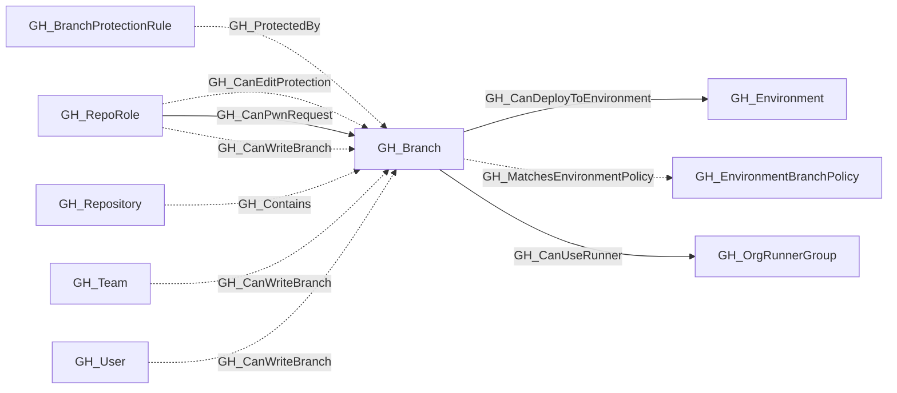

# GH_Branch

## General Information

Represents a Git branch within a repository. Branch nodes capture basic branch information and whether the branch is protected. Protection rule details are stored in separate GH_BranchProtectionRule nodes, linked via GH_ProtectedBy edges.

## Diagram

## References

- [Branch protection API](https://docs.github.com/en/rest/branches/branch-protection)
