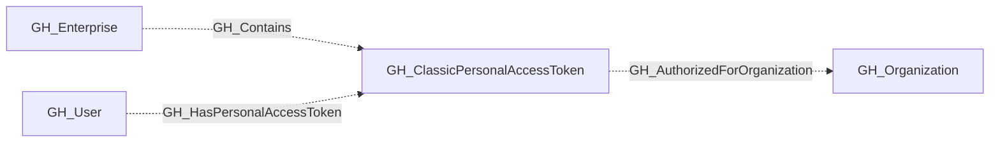

# GH_ClassicPersonalAccessToken

## General Information

A classic personal access token found in the enterprise credential inventory.

## Diagram

## References

- [Personal access token API](https://docs.github.com/en/rest/orgs/personal-access-tokens)
