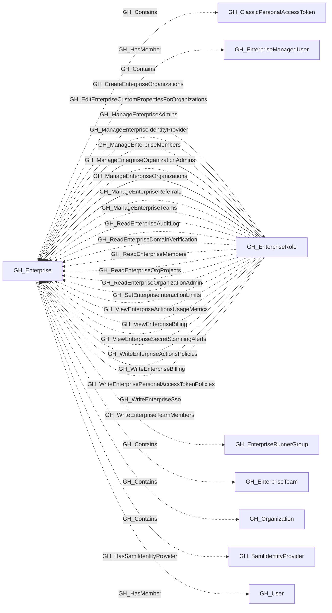

# GH_Enterprise

## General Information

A GitHub Enterprise account that contains organizations, enterprise teams, roles, and managed users.

## Diagram

## References

- [Enterprise roles](https://docs.github.com/en/enterprise-cloud@latest/rest/enterprise-admin/enterprise-roles)
