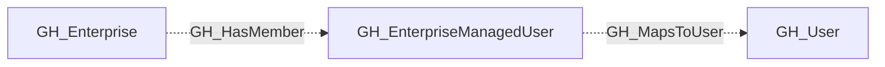

# GH_EnterpriseManagedUser

## General Information

A GitHub Enterprise managed user account linked to an enterprise identity provider.

## Diagram

## References

- [Enterprise SCIM API](https://docs.github.com/en/enterprise-cloud@latest/rest/enterprise-admin/scim)
