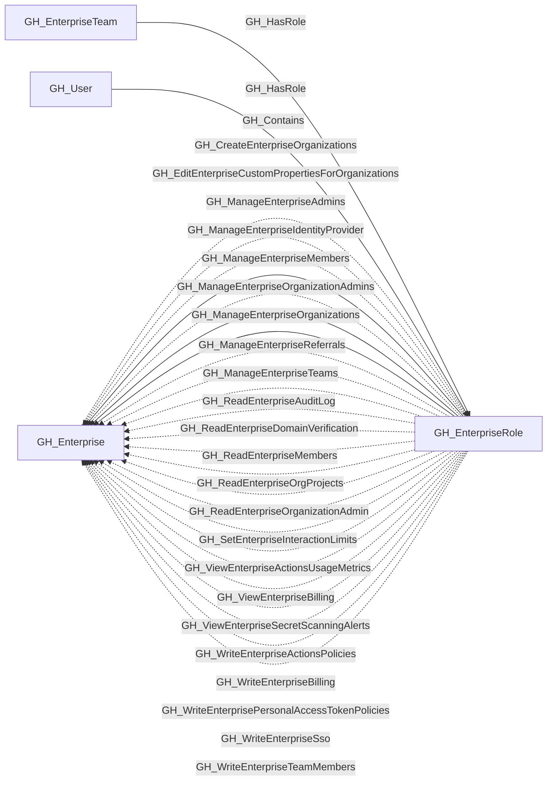

# GH_EnterpriseRole

## General Information

The role a user or team has at the GitHub Enterprise level.

## Diagram

## References

- [Enterprise roles](https://docs.github.com/en/enterprise-cloud@latest/rest/enterprise-admin/enterprise-roles)
