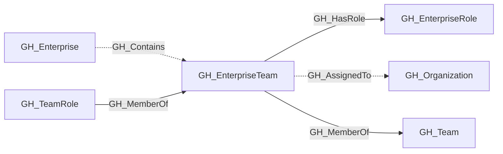

# GH_EnterpriseTeam

## General Information

A team managed at the GitHub Enterprise level and assignable across organizations.

## Diagram

## References

- [Enterprise roles](https://docs.github.com/en/enterprise-cloud@latest/rest/enterprise-admin/enterprise-roles)
