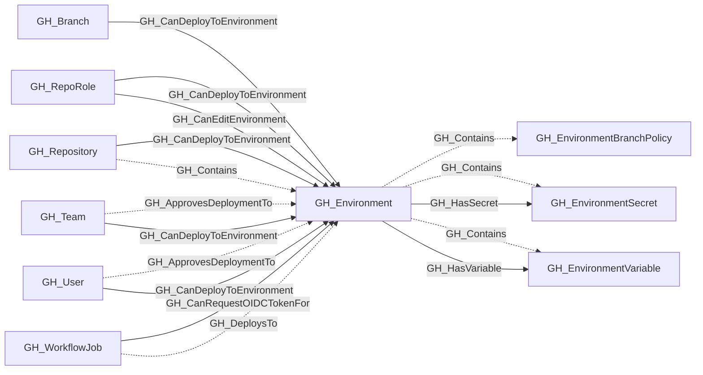

# GH_Environment

## General Information

Represents a GitHub Actions deployment environment configured on a repository. Environments can have protection rules including required reviewers, wait timers, administrator bypass behavior, and deployment branch policies.

Repositories always contain their environments. When custom branch policies are configured, the environment also contains one or more GH_EnvironmentBranchPolicy nodes that describe which branches are allowed to deploy. Environment-scoped secrets and variables are modeled as child nodes of the environment and become available to workflow jobs that reference it.

GH_CanRequestOIDCTokenFor edges from GH_WorkflowJob nodes identify jobs with a static upper-bound capability to request a GitHub-signed OIDC token for this environment because their effective `GITHUB_TOKEN` permissions include `id-token:write`. Runtime permission recalculation, such as forked `pull_request` permission downgrades, may prevent a specific execution from requesting OIDC even when this edge exists.

## Diagram

## References

- [Deployment environments API](https://docs.github.com/en/rest/deployments/environments)
