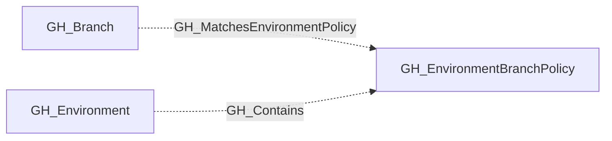

# GH_EnvironmentBranchPolicy

## General Information

Represents a deployment branch policy attached to a GitHub Environment. These policies define which branches or branch patterns are allowed to deploy to the environment, such as `main`, `release/*`, or `release/**/*`.

Environment branch policies are modeled as their own nodes so analysts can distinguish between the environment itself and the matching rules that govern deployment eligibility.

## Diagram

## References

- [Deployment environments API](https://docs.github.com/en/rest/deployments/environments)
