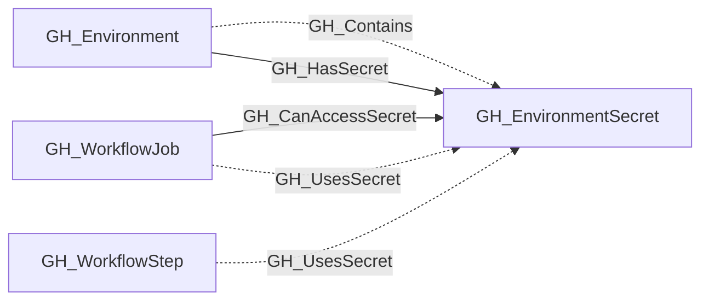

# GH_EnvironmentSecret

## General Information

Represents an environment-level GitHub Actions secret. These secrets are scoped to a specific deployment environment and are only available to workflow jobs that reference that environment.

The containing environment is linked to the secret with GH_Contains and GH_HasSecret edges. Workflow steps that reference the secret by name receive GH_UsesSecret edges when their job targets the same environment.

## Diagram

## References

- [Actions secrets API](https://docs.github.com/en/rest/actions/secrets)
