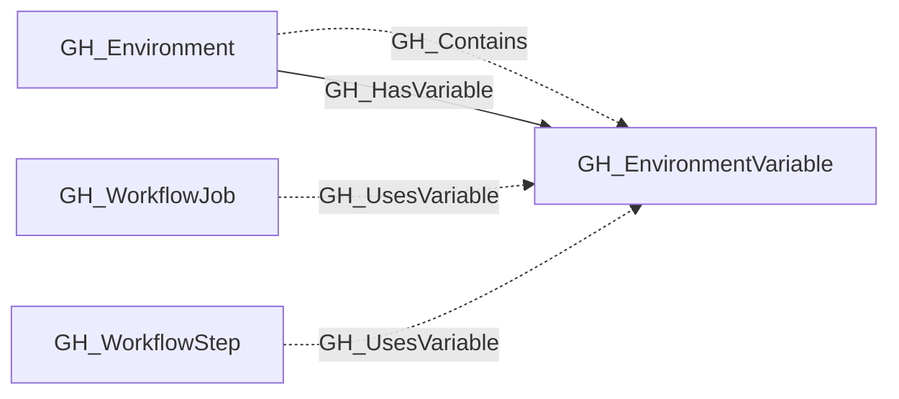

# GH_EnvironmentVariable

## General Information

Represents an environment-level GitHub Actions variable. These variables are scoped to a specific deployment environment and are only available to workflow jobs that reference that environment. Unlike secrets, variable values are readable via the API.

The containing environment is linked to the variable with GH_Contains and GH_HasVariable edges. Workflow steps that reference the variable by name receive GH_UsesVariable edges when their job targets the same environment.

## Diagram

## References

- [Actions variables API](https://docs.github.com/en/rest/actions/variables)
