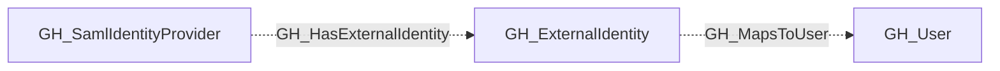

# GH_ExternalIdentity

## General Information

Represents an external identity collected through a SAML or OIDC provider, with a linked GitHub user when available. External identities map corporate user accounts (from providers like Okta, Azure AD, etc.) to GitHub user accounts, enabling single sign-on authentication. SAML attributes, SCIM attributes, and the linked user may be absent.

## Diagram

## References

- [SAML single sign-on](https://docs.github.com/en/enterprise-cloud@latest/authentication/authenticating-with-single-sign-on/about-authentication-with-single-sign-on)
