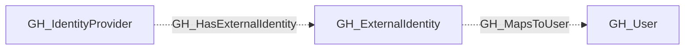

# GH_IdentityProvider

## General Information

A shared, non-display secondary kind on `GH_SamlIdentityProvider` and `GH_OidcIdentityProvider` nodes. Provider-specific kinds retain their display settings and protocol-specific properties.

Use this kind to query providers across both federation strategies:

```cypher
MATCH (provider:GH_IdentityProvider)
RETURN provider
```

## Diagram



## References

- [Enterprise roles](https://docs.github.com/en/enterprise-cloud@latest/rest/enterprise-admin/enterprise-roles)
