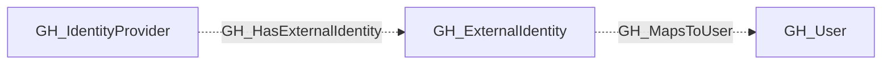

# GH_IdentityProvider

## General Information

A shared, non-display secondary kind on `GH_SamlIdentityProvider` and `GH_OidcIdentityProvider` nodes. Provider-specific kinds retain their display settings and protocol-specific properties.

Use this kind to query providers across both federation strategies:

```cypher
MATCH (provider:GH_IdentityProvider)
RETURN provider
```

## Properties

This secondary kind adds no properties. Nodes retain the properties defined by their provider-specific kind.

## Diagram


