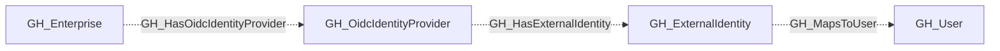

# GH_OidcIdentityProvider

## General Information

Represents an OIDC identity provider configured for a GitHub Enterprise account. Collection queries `enterprise.ownerInfo.oidcProvider` using the supplemental classic PAT. The PAT must belong to an enterprise owner and have `read:enterprise` access.

The node carries `GH_OidcIdentityProvider`, the shared secondary kind `GH_IdentityProvider`, and the source kind `GitHub`.

## Properties

| Property | Description |
| --- | --- |
| `node_id` | GitHub's native GraphQL provider ID. |
| `provider_type` | The OIDC provider type returned by GitHub. |
| `tenant_id` | The identity provider's tenant ID. |
| `environmentid` | The GitHub Enterprise node ID. |
| `environment_name` | The enterprise name. |
| `github_deployment_id` | The GitHub deployment identifier. |
| `github_web_origin` | The GitHub web origin. |

## Relationships

`GH_Enterprise` connects to this node through the non-traversable `GH_HasOidcIdentityProvider` relationship. Provider collection does not emit SAML service provider or SAML account relationships.

The provider connects to its `GH_ExternalIdentity` nodes through non-traversable `GH_HasExternalIdentity` edges. Those identities map to linked `GH_User` nodes through `GH_MapsToUser` when available.

## Diagram

