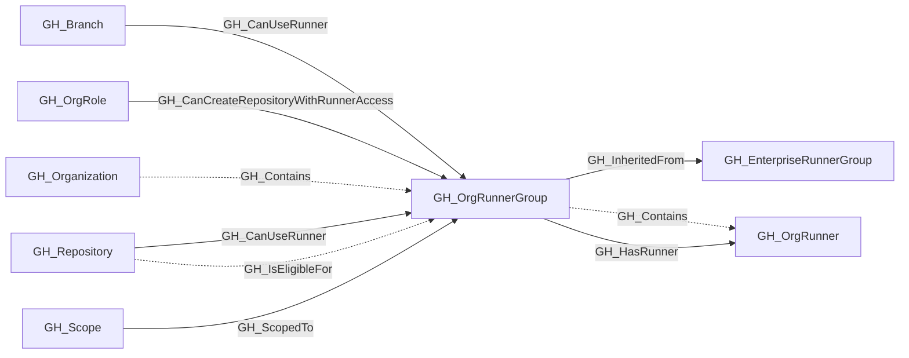

# GH_OrgRunnerGroup

## General Information

Represents a self-hosted runner group visible within a GitHub organization. Organization runner groups may either be native to the organization or inherited from an enterprise runner group.

Native organization runner groups contain GH_OrgRunner nodes directly. Direct memberships also emit GH_HasRunner to represent the traversable capability hop from the group to its runners. Inherited organization runner groups do not directly contain organization runners; instead, they link to the source GH_EnterpriseRunnerGroup through GH_InheritedFrom and gain access to the enterprise runners contained there. GH_IsEligibleFor uses shared runner-group scopes for canonical policies and direct edges for selected policies, while GH_CanUseRunner identifies repositories and branches that can dispatch workflows to the group under collected Actions and workflow-restriction settings.

## Diagram

## References

- [Self-hosted runner groups API](https://docs.github.com/en/rest/actions/self-hosted-runner-groups)
