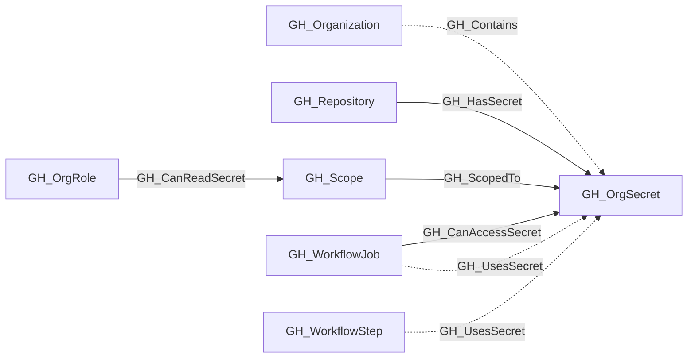

# GH_OrgSecret

## General Information

Represents an organization-level GitHub Actions secret. All and private/internal visibility uses shared organization-secret GH_Scope nodes; arbitrary selected visibility uses direct GH_HasSecret relationships from repositories.

## Diagram

## References

- [Actions secrets API](https://docs.github.com/en/rest/actions/secrets)
