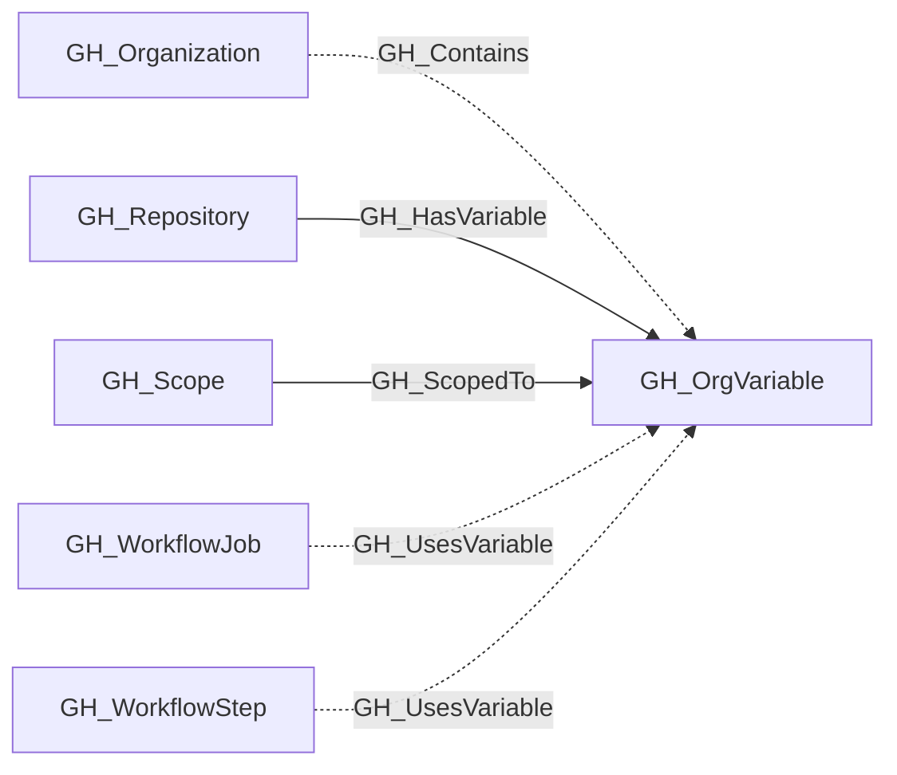

# GH_OrgVariable

## General Information

Represents an organization-level GitHub Actions variable. All and private/internal visibility uses shared organization-variable GH_Scope nodes; arbitrary selected visibility uses direct GH_HasVariable relationships from repositories. Unlike secrets, variable values are readable via the API.

## Diagram

## References

- [Actions variables API](https://docs.github.com/en/rest/actions/variables)
