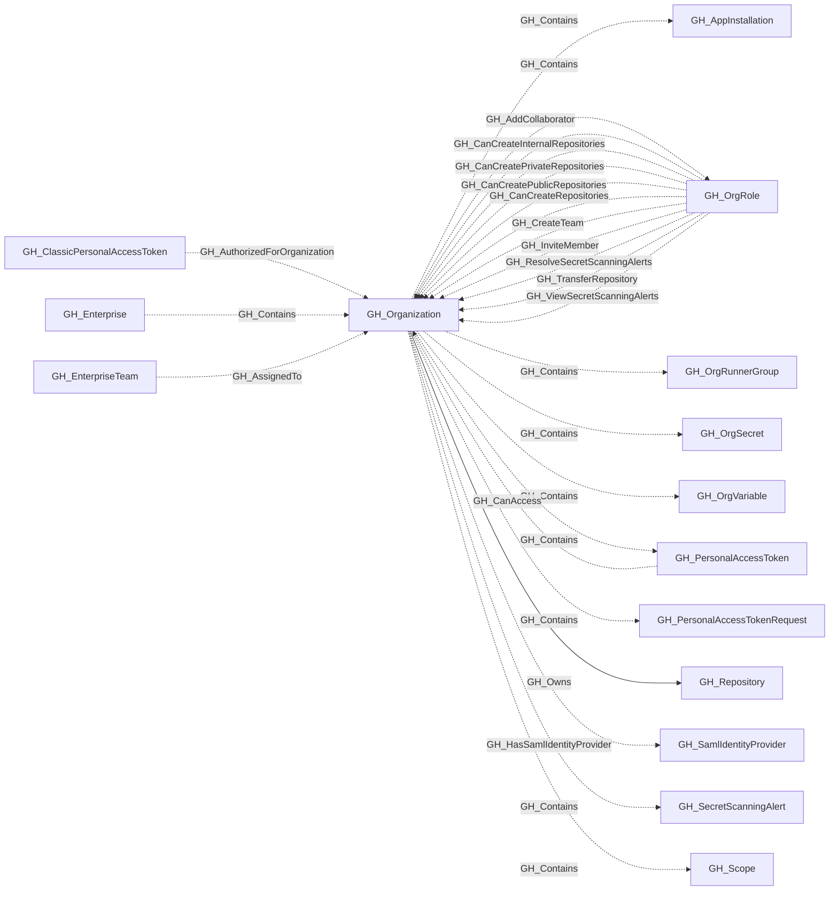

# GH_Organization

## General Information

Represents a GitHub organization. This is the organization-scoped administrative root for its collected repositories, teams, roles and configuration; enterprise-scoped resources have their own root. Organization-level settings such as default repository permissions, Actions configuration, and security features are captured as properties on this node.

## Diagram

## References

- [Organization roles](https://docs.github.com/en/organizations/managing-peoples-access-to-your-organization-with-roles/roles-in-an-organization)
