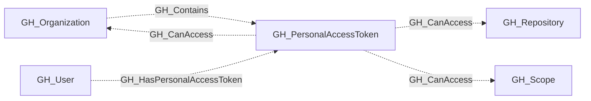

# GH_PersonalAccessToken

## General Information

Represents a fine-grained personal access token that has been granted access to organization resources. PATs are linked to their owning user, the organization, and the repositories they can access. PATs with `repository_selection` set to `all` use the organization's reusable repository/all GH_Scope; subset access remains represented by direct GH_CanAccess edges.

The granted permissions are stored separately as `organization_permissions` and `repository_permissions`. Each property is a list of `scope:access` values such as `members:read` or `contents:write`, matching the permission format used on GH_WorkflowJob nodes.

## Diagram

## References

- [Personal access token API](https://docs.github.com/en/rest/orgs/personal-access-tokens)
