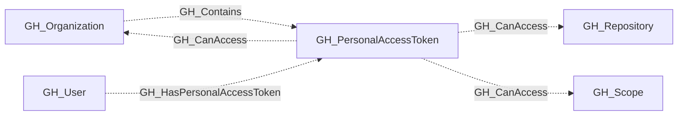

# GH_PersonalAccessToken

## General Information

Represents a fine-grained personal access token that has been granted access to organization resources. PATs are linked to their owning user, the organization, and the repositories they can access. PATs with `repository_selection` set to `all` use the organization's reusable repository/all GH_Scope; subset access remains represented by direct GH_CanAccess edges.

The granted permissions use the same explicit permission catalog as GitHub Apps and are stored as `permission:access` arrays in `permissions_repository`, `permissions_organization`, `permissions_enterprise`, and `permissions_account`. Unknown permission keys are retained in `permissions_unclassified`. Empty categories are empty arrays. These properties describe granted permissions; requests do not establish active access.

Active tokens with `contents:write` receive GH_CanCreateBranch edges only within their granted repository selection and their owner's existing effective GH_CanCreateBranch paths. An all-repository token can use a repository branch-creation scope only if the owner can create branches in every scope member. Otherwise, access is represented by direct repository edges. Expired tokens receive no creation capabilities, and pending requests remain separate. Re-run preprocessing before conversion to load selected repository grants into the lookup.

GH_CanAccess links to the organization only when `permissions_organization` is nonempty. Enterprise links additionally require nonempty `permissions_enterprise` and a uniquely matched collected parent enterprise. Containment alone does not establish organization or enterprise permission scope.

## Properties

| Property | Type | Description |
| --- | --- | --- |
| `name` | `string` | The node name used for matching and display. |
| `displayname` | `string` | The human-readable display name. |
| `environmentid` | `string` | The identifier of the GitHub environment where this node was collected. |
| `last_seen` | `datetime` | The timestamp when this node was last observed during collection. |
| `node_id` | `string` | `PAT_` plus unpadded URL-safe Base64 of MessagePack `[1, organization_database_id, grant_id]`. |
| `environment_name` | `string` | The name of the environment (GitHub organization) where the token has access. |
| `owner_id` | `string` | The GitHub ID of the token owner. |
| `owner_node_id` | `string` | The GraphQL node ID of the token owner. |
| `token_expires_at` | `datetime` | The ISO 8601 timestamp of when the token expires. |
| `token_last_used_at` | `datetime` | The ISO 8601 timestamp of when the token was last used. |
| `access_granted_at` | `datetime` | The ISO 8601 timestamp of when the token was granted to the organization. |
| `permissions_organization` | `list[string]` | Organization-scoped permissions in `permission:access` form. |
| `permissions_repository` | `list[string]` | Repository-scoped permissions in `permission:access` form. |
| `permissions_enterprise` | `list[string]` | Granted enterprise permissions as `permission:access` values. |
| `permissions_account` | `list[string]` | Granted account permissions as `permission:access` values. |
| `permissions_unclassified` | `list[string]` | Granted permissions absent from the shared catalog. |
| `token_name` | `string` | The user-assigned display name of the token. |
| `owner_login` | `string` | The login handle of the user who owns the token. |
| `repository_selection` | `string` | Whether the token has access to `all`, `subset`, or `none` of the organization's repositories. |
| `token_expired` | `boolean` | Whether the token has expired. |

## Diagram

