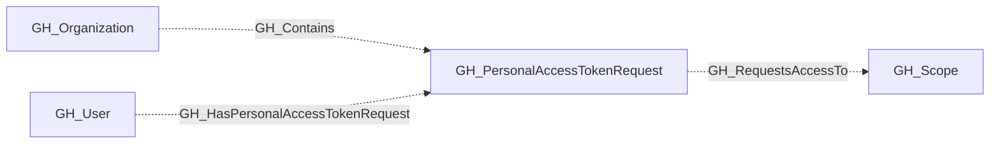

# GH_PersonalAccessTokenRequest

## General Information

Represents a pending request from an organization member to access organization resources with a fine-grained personal access token. PAT requests are linked to their owning user and the organization. An all-repository request also has a non-traversable GH_RequestsAccessTo edge to the organization's repository/all GH_Scope.

The requested permissions are stored separately as `organization_permissions` and `repository_permissions`. Each property is a list of `scope:access` values such as `members:read` or `contents:write`, matching the permission format used on GH_WorkflowJob nodes.

## Diagram

## References

- [Personal access token API](https://docs.github.com/en/rest/orgs/personal-access-tokens)
