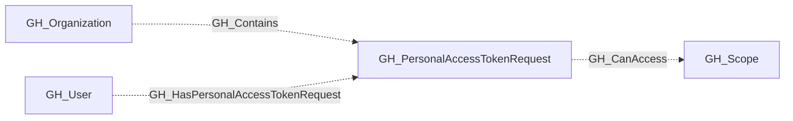

# GH_PersonalAccessTokenRequest

## General Information

Represents a pending request from an organization member to access organization resources with a fine-grained personal access token. PAT requests are linked to their owning user and the organization. An all-repository request also has a non-traversable GH_CanAccess edge to the organization's repository/all GH_Scope.

The requested permissions use the same explicit permission catalog as GitHub Apps and are stored as `permission:access` arrays in `permissions_repository`, `permissions_organization`, `permissions_enterprise`, and `permissions_account`. Unknown permission keys are retained in `permissions_unclassified`. Empty categories are empty arrays. These properties describe requested permissions; requests do not establish active access.

GH_CanAccess is non-traversable scope metadata: on a pending request it describes requested access, not approval or an active capability. Organization links require nonempty `permissions_organization`. Enterprise links require nonempty `permissions_enterprise` and a uniquely matched collected enterprise parent. Selected repository requests are collected from the request repositories endpoint; all-repository requests use the shared scope.

## Properties

| Property | Type | Description |
| --- | --- | --- |
| `name` | `string` | The node name used for matching and display. |
| `displayname` | `string` | The human-readable display name. |
| `environmentid` | `string` | The identifier of the GitHub environment where this node was collected. |
| `last_seen` | `datetime` | The timestamp when this node was last observed during collection. |
| `node_id` | `string` | `PATR_` plus unpadded URL-safe Base64 of MessagePack `[1, organization_database_id, request_id]`. |
| `token_name` | `string` | The user-assigned display name of the token. |
| `owner_login` | `string` | The login handle of the user who submitted the request. |
| `repository_selection` | `string` | Whether the request targets `all`, `subset`, or `none` of the organization's repositories. |
| `reason` | `string` | The rationale provided by the requester for the access request. |
| `org_name` | `string` | The org name property. |
| `permissions_organization` | `list[string]` | Requested organization-scoped permissions in `permission:access` form. |
| `permissions_repository` | `list[string]` | Requested repository-scoped permissions in `permission:access` form. |
| `permissions_enterprise` | `list[string]` | Requested enterprise permissions as `permission:access` values. |
| `permissions_account` | `list[string]` | Requested account permissions as `permission:access` values. |
| `permissions_unclassified` | `list[string]` | Requested permissions absent from the shared catalog. |

## Diagram

