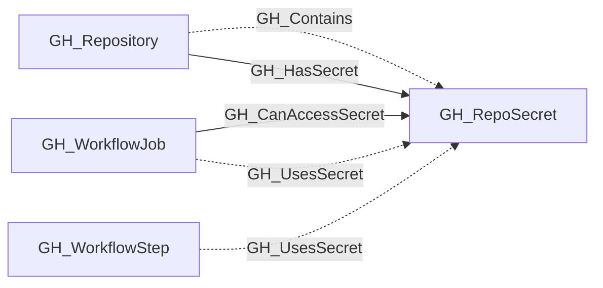

# GH_RepoSecret

## General Information

Represents a repository-level GitHub Actions secret. These are secrets defined directly on a specific repository and are only accessible to workflows running in that repository.

## Diagram

## References

- [Actions secrets API](https://docs.github.com/en/rest/actions/secrets)
