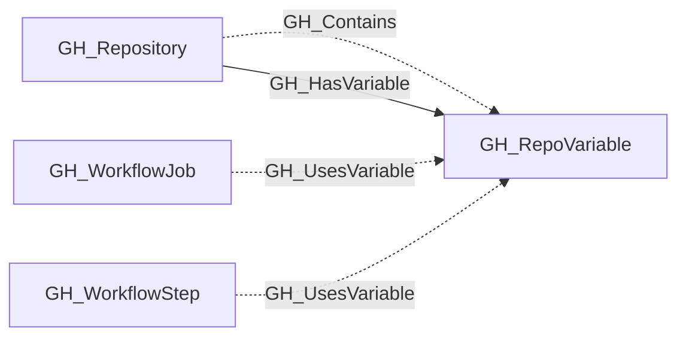

# GH_RepoVariable

## General Information

Represents a repository-level GitHub Actions variable. These are variables defined directly on a specific repository and are only accessible to workflows running in that repository. Unlike secrets, variable values are readable via the API.

## Diagram

## References

- [Actions variables API](https://docs.github.com/en/rest/actions/variables)
