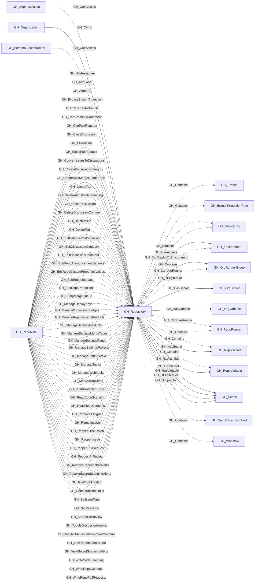

# GH_Repository

## General Information

Represents a GitHub repository within the organization. Repository nodes capture metadata about the repo including visibility, Actions enablement status, and security configuration. Repository role nodes (GH_RepoRole) are created alongside each repository to represent the permission levels available.

For repositories with active workflows, the collector records the applicable default workflow permissions and whether workflows may approve pull request reviews. These properties preserve the repository-level policy input later used to derive effective GITHUB_TOKEN permissions for GH_WorkflowJob nodes.

The `branch_count` and `environment_count` properties preserve GitHub-reported totals from the repository GraphQL response. These values can be compared to collected GH_Branch and GH_Environment children to identify incomplete collection before relying on branch- or environment-dependent analysis.

Every repository is linked from its organization's reusable repository/all GH_Scope. Private and internal repositories are also linked from repository/private_or_internal. This supports compact one- or two-hop access queries without repeating one GH_CanAccess edge per credential and repository.

Repositories also point to runner_group/all GH_Scope nodes through GH_IsEligibleFor; private and internal repositories additionally point to runner_group/private_or_internal. Those scopes enumerate canonical runner groups through GH_ScopedTo, while groups with arbitrary selected repository policies remain direct.

Organization secrets and variables with canonical all/private visibility are similarly reached through organization_secret and organization_variable scopes. Repository-owned, environment-owned, and arbitrarily selected organization assets remain direct targets.

Runner, secret, and variable boundary edges are emitted only when the organization has a matching canonical target, so empty scopes do not add per-repository edges.

## Diagram

## References

- [Repository roles](https://docs.github.com/en/organizations/managing-access-to-your-organizations-repositories/repository-roles-for-an-organization)
