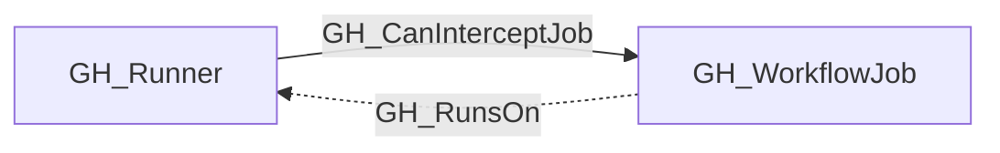

# GH_Runner

## General Information

Generic label applied to GitHub self-hosted runner nodes across enterprise, organization, and repository scope.

## Diagram

## References

- [Self-hosted runners API](https://docs.github.com/en/rest/actions/self-hosted-runners)
