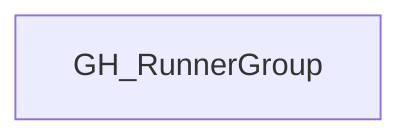

# GH_RunnerGroup

## General Information

Generic label applied to GitHub self-hosted runner group nodes across enterprise and organization scope.

## Diagram

## References

- [Self-hosted runner groups API](https://docs.github.com/en/rest/actions/self-hosted-runner-groups)
