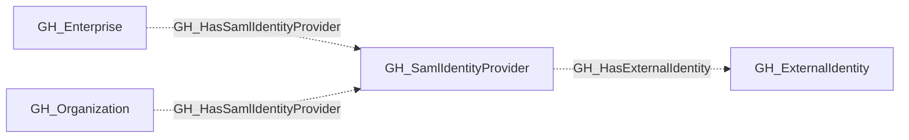

# GH_SamlIdentityProvider

## General Information

Represents a SAML identity provider configured for an organization or enterprise. This node captures the SAML SSO configuration details and serves as the parent container for external identity mappings. Through external identities, it enables linking GitHub users to their corporate identities in the identity provider.

## Diagram

This node also carries the non-display secondary kind `GH_IdentityProvider`, shared with enterprise OIDC providers.

## References

- [SAML single sign-on](https://docs.github.com/en/enterprise-cloud@latest/authentication/authenticating-with-single-sign-on/about-authentication-with-single-sign-on)
