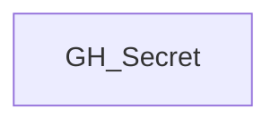

# GH_Secret

## General Information

Generic label applied to GitHub secret nodes across organization, repository, and environment scope.

## Diagram

## References

- [Actions secrets API](https://docs.github.com/en/rest/actions/secrets)
