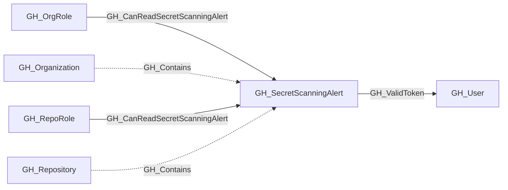

# GH_SecretScanningAlert

## General Information

Represents a GitHub secret scanning alert detected in a repository. Secret scanning alerts are raised when GitHub detects a known secret pattern (such as an API key, token, or credential) committed to a repository. The alert captures the secret type, validity status, and current resolution state.

## Diagram

## References

- [Secret scanning API](https://docs.github.com/en/rest/secret-scanning/secret-scanning)
