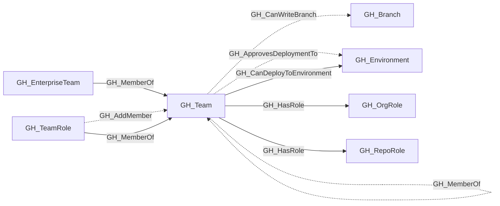

# GH_Team

## General Information

Represents a GitHub team within the organization. Teams can have parent-child relationships, contain members with different roles (Member, Maintainer), and be assigned to repository roles.

## Diagram

## References

- [Team membership API](https://docs.github.com/en/rest/teams/members)
