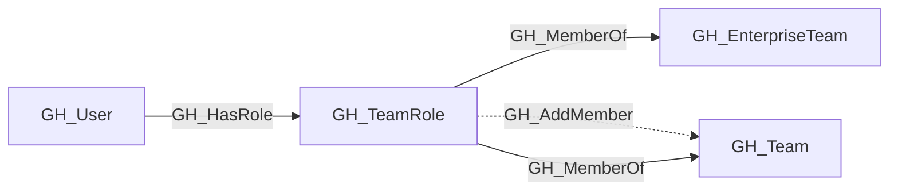

# GH_TeamRole

## General Information

Represents a role within a GitHub team. Each team has two built-in roles: Member and Maintainer. Maintainers can add and remove team members. Team roles connect users to teams and transitively to any repository roles assigned to the team.

## Diagram

## References

- [Team membership API](https://docs.github.com/en/rest/teams/members)
